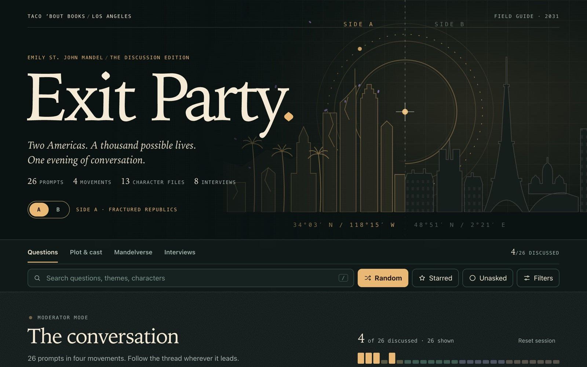
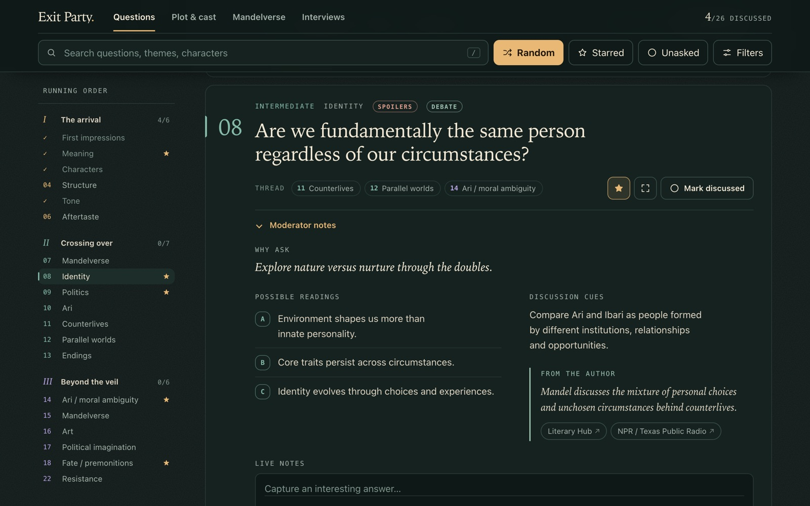
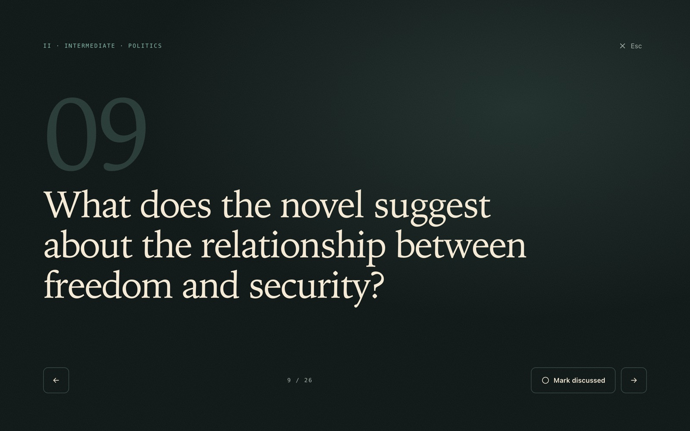
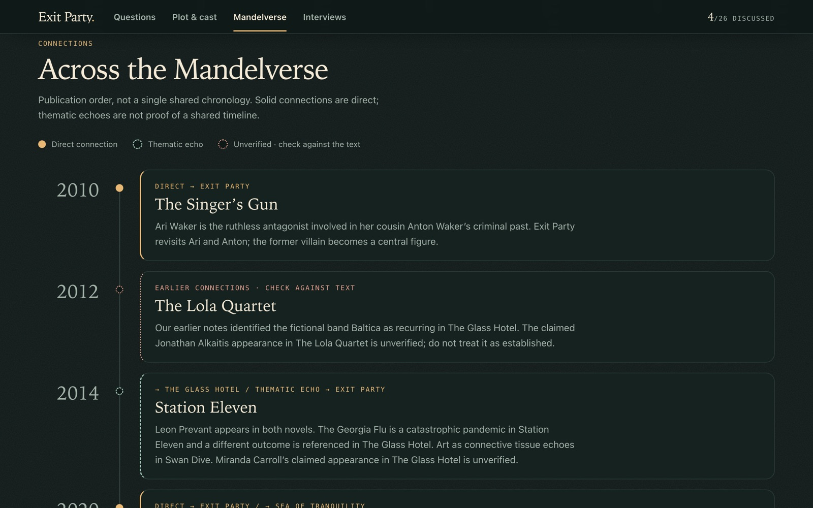
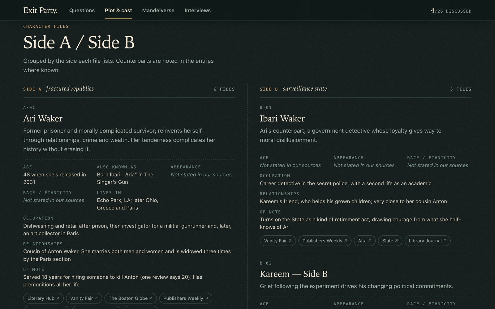
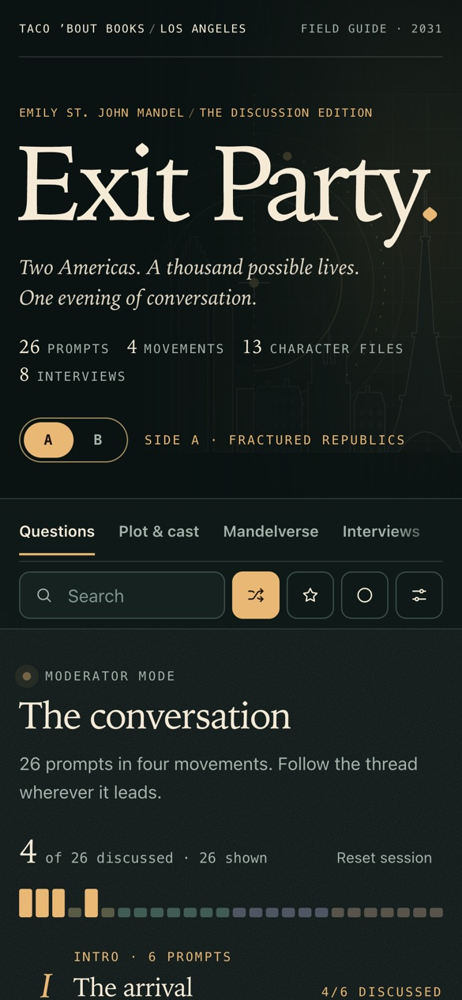
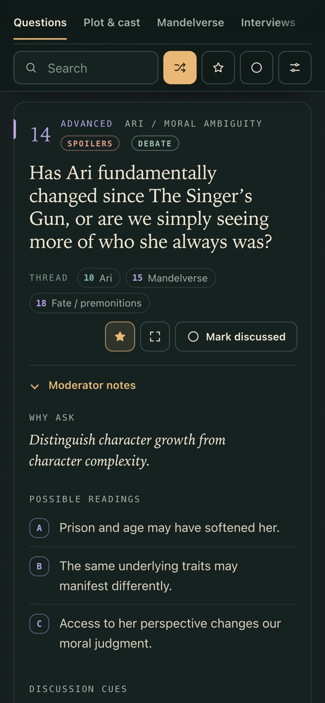

# Exit Party: Moderator's Field Guide

A single-page discussion dashboard for leading a book club conversation about *Exit Party* by Emily St. John Mandel. It is built for a live room: a moderator opens it on a laptop or phone and works through the questions.

No build step, no server, no dependencies. It is one HTML file.

> **Spoiler warning.** The Plot & cast and Mandelverse tabs contain full-novel spoilers.



## Features

- **26 discussion questions** in four movements (I · The arrival, II · Crossing over, III · Beyond the veil, IV · The afterparty), each with:
  - why to ask it,
  - possible readings,
  - discussion cues,
  - author perspective with links to interviews,
  - linked follow-up questions ("the thread"),
  - a live notes box.
- **Moderator tools:** search (press `/`), a Filters panel (level, spoilers, debate picks, expand all notes), starred questions, "unasked only", and a random-question picker that favors questions not yet discussed.
- **Running order:** on wide screens, a sticky sidebar lists every question by movement, marks discussed and starred ones, and follows your scroll position.
- **Presenter mode:** show one question full screen for the room, step with ← / →, mark it discussed, and press Esc to return.
- **Session tracking:** a progress bar with one segment per question, color-coded by movement, plus "mark discussed" and per-question notes.
- **Reference tabs:** plot refresher, character files split by side (each with sourced details like age, aliases, appearance, race/ethnicity and relationships, plus "Check your copy" notes where reviews don't back up our notes), recurring motifs, a Mandelverse timeline whose legend distinguishes direct links, thematic echoes and unverified claims, and interview cards showing which questions cite each source.
- **Side A / Side B:** two visual worlds, not just two palettes. Side A is warm dusk over a Los Angeles skyline, with palms and drifting jacaranda petals. Side B is cold and rigid over a Paris skyline, with lit windows, camera lights and a scanning beam. Switching plays a circular reveal.
- Responsive down to phone width, keyboard and screen-reader friendly, reduced-motion aware, and a print stylesheet that expands every note into a paper field guide.

## Screenshots

**Side B.** Flip the switch and the page turns cold and rigid: square corners, and the Paris half of the skyline lights up with windows, camera lights and a scanning beam.


**Questions.** The running order tracks where you are in the evening. Moderator notes open into why to ask, possible readings, discussion cues and the author's perspective.



**Presenter mode.** One question, full screen, for the room.



**Mandelverse.** The legend matches the timeline: solid for direct links, dashed for thematic echoes, dotted for unverified claims.



**Character files**, split by side, each with sourced details and a source list.



**On a phone.**

<p>
  
  &nbsp;
  
</p>

## Quick start

Open the file in any modern browser:

```bash
open exit-party-deluxe.html
```

Or serve the folder locally:

```bash
python3 -m http.server 8000
# then visit http://localhost:8000/exit-party-deluxe.html
```

## Privacy and data

There is no backend and nothing is sent anywhere. Stars, discussed status, live notes and the Side A/B choice are saved in your browser's `localStorage` under the key `exit-party-session`. They are per-browser and per-device. Clearing site data erases them.

## Project layout

```
exit-party-deluxe.html   # the whole app: markup, CSS, content data and JS
README.md                # this file
CONTRIBUTING.md          # how to contribute
CLAUDE.md                # orientation for AI coding assistants
docs/screenshots/        # images used in this README
```

## Contributing

Contributions are welcome, especially new questions, corrections and better sources. See [CONTRIBUTING.md](CONTRIBUTING.md).

## Content and sources

Plot and character summaries are discussion refreshers assembled from published interviews and the organizer's notes. The detail fields on each character file come only from the reviews and interviews linked on that file. Anything they don't cover reads "Not stated in our sources", and claims they don't support are flagged "Check your copy". They are **not** verified chapter by chapter against the novel. Some items, such as certain Mandelverse cameos, are explicitly marked unverified in the app. Please check details against your copy before correcting or adding anything.

Interview links point to the original publishers. Summaries are paraphrased, not quoted at length. Please keep it that way.

## Disclaimer

This is an unofficial fan project for book club discussion. It is not affiliated with or endorsed by the author or publisher.

## License

Released under the [MIT License](LICENSE).
